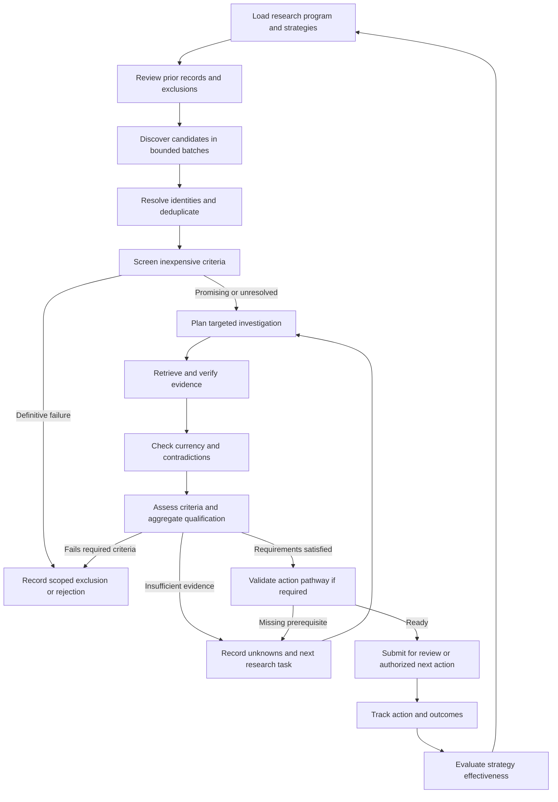
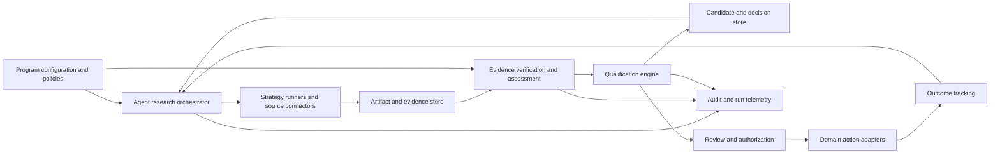

# Agentic High-Throughput Screening Research Flow — System Design

**Status:** Draft for review  
**Scope:** Domain-independent research and qualification, with separate implementation and use-case mappings

## 1. Purpose and scope

Design a reusable system for discovering, investigating, and qualifying a small number of actionable opportunities from a much larger, noisy set of potential candidates. The system coordinates research agents, evidence evaluation, persistent records, and decisions. Its output is not a list of interesting search results: it is a set of candidates whose qualification states and proposed next actions are explicitly supported by recorded evidence.

The flow applies wherever useful candidates are scattered across heterogeneous sources and eligibility cannot be established by a single structured query. Examples include job searches, sales prospecting, drug-discovery target or compound triage, and comparison shopping. Their criteria, evidence standards, consequences, and downstream workflows differ; the research architecture need not.

**In scope:** strategy configuration, discovery, deduplication, inexpensive screening, deeper investigation, evidence provenance and currency, qualification, unresolved cases, persistent state, human review, and learning from observed research outcomes.

**Out of scope for the common core:** domain-specific qualification rules, any particular database or framework, automatic execution of consequential downstream actions, and a claim that a research finding guarantees a real-world result. Domain-specific safety, regulatory, and scientific validation must be supplied by the application.

## 2. Problem: Agentic HTS Research

Most agentic research systems are designed for deep research—investigating a bounded question and synthesizing an answer—while continuous discovery and qualification of candidates requires a different research model.

### 2.1 High-Throughput Screening Research

**Deep research** investigates a question for which the intended result is an answer, explanation, or synthesis. It gathers and evaluates sources, resolves relevant uncertainties, and produces a report or conclusion. Typical questions include “What are the known side effects of acetaminophen?” or “What habitats support Monterey pine?” A research run can finish when its defined question has been answered to the required standard, even if later discoveries might warrant an update.

**High-throughput screening (HTS) research** investigates a potentially large, changing, or unbounded population to identify the relatively few candidates that satisfy specified criteria. Its output is a continuing stream or maintained collection of qualified candidates, with evidence supporting each decision. Typical questions include:

- Which currently available jobs meet this search's requirements?
- Which organizations show current, verifiable evidence of a need for a particular service?
- Which compounds or specimens warrant further examination against defined experimental criteria?
- Which products currently satisfy a buyer's requirements for compatibility, availability, and price?

HTS research is not necessarily a single pass over a known list. Candidates may emerge from multiple sources indefinitely; previously examined candidates may change; and each candidate may require its own investigation before it can be qualified. Runs and batches are finite, but the research objective need not have a final, exhaustive answer.

The term *high-throughput screening* is borrowed from scientific screening. Here it describes a domain-independent pattern of **repeated candidate discovery, staged evaluation, and selective deeper investigation**, rather than a claim that all domains use the same experimental methods or volumes.

| Dimension | Deep research | HTS research |
| --- | --- | --- |
| Central question | What is the answer to this question? | Which candidates satisfy these criteria? |
| Research scope | Bounded by a question and its evidence | Open or changing candidate population |
| Unit of work | An investigation contributing to a synthesis | An individual candidate or bounded candidate batch |
| Main output | An answer, explanation, or report | A maintained set or pipeline of qualified candidates |
| Completion | A run ends when the question is adequately answered | A batch ends, but discovery and reassessment can continue |
| Quality measure | Accuracy, coverage, and support for conclusions | Qualification correctness, useful yield, coverage, and research efficiency |

### 2.2 Unique Problems Presented by HTS

- **Open-ended coverage.** The candidate population is not necessarily known, finite, or exhaustively searchable. Source coverage and search bounds must be tracked rather than equated with completeness.
- **Scale and selectivity.** Many discovered candidates will not qualify. Applying full-depth investigation to every hit is costly; premature elimination can discard valid candidates.
- **Discovery–qualification gap.** A source hit may only suggest a candidate. Eligibility often depends on additional, candidate-specific facts that are not present in the discovery source.
- **Uneven evidence cost.** Basic disqualifiers can be inexpensive to check, while decisive facts may require cross-source investigation, identity resolution, or expert interpretation.
- **Heterogeneous and ambiguous evidence.** Sources differ in structure, terminology, reliability, and attribution. Signals may admit several explanations, and some criteria cannot be evaluated deterministically.
- **Time-dependent eligibility.** New candidates appear and existing conditions change. Historical evidence of a qualifying condition does not necessarily establish current eligibility.
- **Incomplete observability.** Some requirements cannot be verified with accessible evidence. Unknown or conflicting findings must remain distinct from confirmed failures and successes.
- **Recurrent work and duplication.** The same candidate or source may recur across searches and runs. Prior findings should be reused without treating old assessments as permanently valid.
- **Candidate-specific actionability.** Meeting substantive criteria may not establish a viable next step; additional prerequisites can require separate verification.
- **Persistent, auditable decisions.** Research spans batches and agent sessions. Assessments, sources, unresolved questions, exclusions, and changes must remain traceable.

The objective is to maximize **correctly qualified, actionable candidates per unit of research effort**, subject to the research program's evidence, coverage, and safety requirements—not the number of search hits or positive classifications.

## 3. Solution: Research Flow

A configurable agentic research flow repeatedly discovers candidates, screens them in stages, verifies the evidence required for qualification, and maintains persistent, reviewable results.

### 3.1 Research Flow Overview

Each **research program** defines its candidate population, eligibility criteria, evidence requirements, discovery strategies, and permitted actions. An agent executes that program in bounded batches, using persistent records so each run builds on prior work.

The flow is:

```text
Configure program and strategies
→ Review existing candidates, decisions, and unresolved work
→ Discover candidates across selected sources
→ Resolve identities, deduplicate, and screen inexpensive criteria
→ Investigate promising or unresolved candidates
→ Verify evidence, currency, and contradictions
→ Assess criteria and determine qualification
→ Verify action prerequisites where required
→ Record results and route for review or authorized action
→ Reassess when new evidence or conditions warrant it
```

Discovery strategies determine **where to look**; qualification criteria determine **what counts**. Candidates, source evidence, criterion assessments, and decisions are separate records. A candidate may be screened out, qualified, or left unresolved for further research. Its qualification is specific to the program and the evidence available at the time.

The system favors inexpensive screening before costly investigation, but does not convert missing evidence into a negative finding. Research progresses through explicit tasks and state changes rather than relying on an agent's conversation history. Sections 4–6 define the model, lifecycle, and architecture in detail.

### 3.2 Design Principles

1. **Program-defined rules.** Version criteria, evidence requirements, strategies, and decision authority per research program.
2. **Separate stages.** Keep discovery, evidence assessment, qualification, and authorization distinct.
3. **Evidence-backed decisions.** Link material claims and decisions to attributable sources; distinguish observations from inferences.
4. **Staged effort.** Screen inexpensive requirements first; allocate deeper research to viable or unresolved candidates.
5. **Time-aware verification.** Record source and assessment dates; check current eligibility against applicable freshness rules.
6. **Explicit uncertainty.** Represent failed, satisfied, unknown, conflicted, and inapplicable conditions separately.
7. **Persistent reuse.** Deduplicate shared entities and evidence; preserve program-specific assessments and decision history.
8. **Controlled actions.** Require the applicable authorization before consequential downstream actions.
9. **Measured iteration.** Record coverage, yield, research cost, failure reasons, and outcomes to evaluate and refine strategies.

## 4. Conceptual model

| Concept | Meaning |
| --- | --- |
| **Research program** | A bounded objective, eligibility criteria, evidence requirements, active strategy set, and approval policy. |
| **Research strategy** | A method and source scope for generating candidates; includes order/priority, stopping conditions, and batch budget. |
| **Candidate** | An entity, item, relationship, or opportunity under consideration, independent of whether it qualifies. |
| **Source artifact** | Original information with locator, publisher/source, capture time, source time when known, and retrievable content or excerpt. |
| **Evidence assertion** | An atomic claim supported, refuted, or left unresolved by cited source artifacts, with scope and time applicability. |
| **Criterion** | An eligibility requirement or preference, including how it is evaluated and what evidence is sufficient. |
| **Assessment** | Evaluation of one criterion for one candidate under one research program, with rationale and supporting assertions. |
| **Qualification decision** | Aggregate result of required criteria and program rules, with version and attribution. |
| **Research task** | A bounded next investigation intended to resolve a specific unknown or contradiction. |
| **Action pathway** | The validated means and prerequisites for taking the next domain-specific action, when required. |
| **Review / authorization** | A decision by an authorized actor to advance, defer, reject, or initiate a consequential action. |
| **Outcome** | What happened after research or pursuit, used for traceability and method evaluation. |

**Identity separation:** A candidate can exist independently of any program; its qualification is always relative to a particular program and a particular version of the rules and evidence. Multiple candidates may reference the same organization, product, person, publication, or source without duplicating their identity.

**Claim separation:** A source is not itself an assertion that the candidate qualifies. A claim such as “condition X existed on date Y” is different from “condition X remains active now,” and both differ from “condition X meets criterion Z.”

## 5. General research lifecycle



### 5.1 Program initialization

Load the current program configuration, effective rule versions, assigned strategies, explicit inclusions/exclusions, recent research, unresolved tasks, and authorization policy. Check that the operator has the required source access and that configuration and procedures are available. Record the run's configuration snapshot to make later decisions reproducible.

### 5.2 Strategy-led discovery

Execute assigned strategies in their configured order and bounded batches. A strategy identifies *where and how to find candidates*, not a substitute standard for qualifying them. Store the original discovery signal and source even when it is insufficient to qualify the candidate. Track coverage, yield, and search bounds; do not report a search as exhaustive without evidence.

### 5.3 Identity resolution and inexpensive screening

Normalize candidate identifiers and detect duplicates. Preserve ambiguity rather than merging distinct entities on superficial similarity. Apply cheap deterministic exclusions and simple evidence checks; only treat a failure as definitive if the applicable rule and evidence establish it. Route otherwise promising or ambiguous cases into targeted investigation.

### 5.4 Targeted investigation and current-state verification

For survivors, identify the smallest missing claims required for a decision and gather evidence targeted to them. Prefer primary and directly attributable sources when the program requires them. Evaluate source relevance, credibility, scope, publication date, capture date, and later contradictory evidence. A newly accessed old source does not automatically become new evidence of current validity.

### 5.5 Criterion assessment and qualification

Evaluate each criterion by its specified method:

- **Deterministic:** direct comparison or reproducible calculation on verified inputs.
- **Evidence-based heuristic:** structured interpretation with explicit claims, rationale, and allowed uncertainty.
- **Composite:** logical or weighted aggregation over other assessments, according to the program's rules.
- **Manual override:** an explicitly attributed, authorized exception with recorded scope and rationale.

A suggested baseline assessment vocabulary is **satisfied**, **failed**, **unknown**, **conflicted**, and **not applicable**. The program decides how these states aggregate; unknown must not silently count as satisfied or failed. Store both the raw assessments and the aggregate decision.

### 5.6 Actionability and review

Qualification and readiness for action are distinct. If a program requires a reachable person, booking path, supply channel, procurement process, or experimental validation step, verify that prerequisite independently. Prepare a review package containing the candidate, supporting claims, counterevidence, outstanding caveats, and intended action. Do not infer permission to contact, purchase, submit, or act from the mere fact of qualification.

### 5.7 Follow-through and re-evaluation

Record authorized actions, responses, and outcomes. Reopen or reassess candidates when source evidence changes, when configured freshness limits expire, or when a new strategy exposes material contradictions. Preserve past decisions and the evidence state under which they were made; update current assessments rather than rewriting history.

## 6. Logical architecture



**Program/configuration service:** Maintains versioned criteria, heuristic instructions, evidence gates, overrides, strategy assignments, and action authorities.

**Agent orchestrator:** Breaks work into bounded tasks; prioritizes unknowns; schedules discovery and investigation; prevents duplicate concurrent work; supports restart and recovery. Agents should persist results through explicit service operations rather than rely on conversation context as the record.

**Source adapters:** Retrieve and normalize public or authorized source data. Preserve raw content or sufficient reproducible references subject to licensing, privacy, and retention limits. Record retrieval errors and access restrictions instead of inventing substitute evidence.

**Evidence service:** Stores artifacts, source metadata, claims, links to candidates, validity windows, counterevidence, and verification attempts. Separates directly observed facts from interpretation.

**Qualification engine:** Applies program-specific deterministic checks and structured heuristic assessments; computes state from the current evidence and rules; records why each gate passed, failed, or remained unknown.

**Workflow and decision service:** Maintains current research state, queued work, authorized transitions, immutable decision/audit events, and review requests. A status change is not a replacement for a complete evidence record.

**Action adapters:** Domain-specific integrations for carrying out only explicitly authorized post-qualification actions.

**Reporting:** Measures discovery volume, deduplicated candidates, screen-out counts, investigation effort, verified qualification yield, unresolved reasons, and downstream outcomes by strategy and configuration version.

These are logical responsibilities, **not a requirement for separate microservices**. One application may implement several responsibilities within one transactional database and worker system.

## 7. Proposed data and state contracts

The implementation should support at least:

- `Program(id, objective, criteria_version, strategies, authority_policy, active)`
- `Strategy(id, program_id, priority, source_scope, instructions_version, budget, stopping_rules)`
- `Candidate(id, canonical_identity, aliases, entity_type)`
- `ProgramCandidate(program_id, candidate_id, lifecycle_state, discovery_context, last_assessed_at)`
- `Artifact(id, uri, publisher, published_at?, captured_at, content_hash?, retention_ref?)`
- `Assertion(id, candidate_id, proposition, evidence_artifact_ids, time_scope, polarity, verification_state)`
- `CriterionAssessment(program_id, candidate_id, criterion_version, state, assertion_ids, rationale, assessor, assessed_at)`
- `Decision(id, program_id, candidate_id, rules_version, disposition, reason, actor, timestamp)`
- `ResearchTask(id, candidate_id, question, priority, status, assigned_to, attempted_sources)`
- `ActionPrerequisite(program_id, candidate_id, type, status, evidence_ids)`
- `AuthorizedAction(id, candidate_id, action_type, authorization, state, outcome)`
- `ResearchRun(id, program_id, configuration_snapshot, source_bounds, counters, started_at, ended_at)`

Names and storage representations are illustrative. A minimal implementation may combine entities while preserving their semantic separation.

**Suggested research states:** `discovered`, `screening`, `investigating`, `awaiting_evidence`, `ready_for_review`, `excluded`, `rejected`, `closed`. These describe research workflow, not the complete domain lifecycle. Transitions require an attributable actor, reason, timestamp, and any configured evidence gates; derived qualification and human disposition remain separate fields.

**Decision scope:** Program-specific exclusion and globally invalid candidate identity are different operations. Global rejection must not be inferred from failure in one program. Explicit overrides must be scoped and auditable.

## 8. Agent execution and control

Each bounded research unit should have a question, permissible sources, stopping or budget condition, required evidence checks, and a structured output. Agents should be able to return **no qualifying candidates** without pressure to pad results.

Before writing a decision, the operator must confirm the effective program rules, review earlier candidate records, and verify that claims support the exact criteria. Unknown facts, unavailable sources, and conflicting evidence should produce research tasks or explicit unresolved states, not fabricated certainty.

The orchestrator must be restartable and idempotent where practical. It should use stable candidate identities, source hashes where available, deduplication checks, and transactionally guarded state changes. Work may be parallelized where independent, but decision updates require concurrency control.

Record each operation under the actual authorized agent identity. Do not impersonate the user or an administrator. Keep user approvals and agent observations distinguishable. Secrets, access scopes, and data handling are connector- and domain-specific; least privilege and auditability are baseline requirements.

## 9. Quality, evaluation, and acceptance criteria

**Quality gates:**

- A candidate cannot be represented as qualified when a required criterion is unresolved or failed, except through an authorized explicit override.
- Every material evidence-based decision has a source link or preserved artifact, a time applicability judgment, and an attributable rationale.
- Contradictory later evidence triggers reassessment rather than automatic retention of a prior positive signal.
- A successful discovery does not automatically authorize downstream action.
- A research run reports verified counts and reasons for attrition; zero qualifying outcomes are valid.
- Restarting a run does not duplicate candidates or erase prior research and decision history.
- Changes to program rules can be traced to the versions used for existing decisions.

**Evaluation measures:** deduplicated discovery yield, screening precision and error audits, proportion of qualified candidates verified on recheck, evidence completeness, research time/cost per qualified candidate, unresolved-case backlog, age of qualifications, and action/outcome conversion where observed. Metrics should not incentivize inflation of qualification counts.

**Test scenarios:** stale source versus current corroboration; false-positive candidate; contradictory primary sources; ambiguous identity; repeated discovery across strategies; missing source access; rule-version change; program-local rejection versus global rejection; expired action prerequisite; denied authorization; interrupted/retried task; human override with preserved reason.

## 10. Frappe implementation

Frappe is **one concrete implementation**, not a dependency of the generalized model. The existing projects demonstrate use of Frappe DocTypes, linked records, workflow states, operator documentation, agent-accessible operations, and persistent source-backed decisions.

A Frappe realization can map the core concepts to DocTypes and child tables: program/search/campaign configuration, research strategies, candidate records, linked organizations and people, source/evidence records, criterion assessments, decision history, research tasks, review requests, and authorized actions. Frappe permissions, workflow transitions, server-side validation, and background jobs can enforce the relevant boundaries. The UI can expose queues for discovery, research, unresolved issues, review, and follow-through.

The two existing deployments are **different domain models**, not proof that a single generic Frappe schema has already been implemented. A shared reusable Frappe app or common interface would be a future design choice. It should not force the current applications to use identical DocTypes or transitions.

Frappe-specific operational requirements include reading the **live authoritative operator documentation** designated by each project, checking the current configuration rather than using remembered rules, storing work in the existing system of record, and performing agent edits using the agent's own account—not the user's or `Administrator`.

## 11. Use case: Job Search

**Goal:** Discover specific, verifiable, currently active openings satisfying a selected Job Search and establish the required actionable pursuit path.

- A **Job Search** configures deterministic filters, heuristics, explicit inclusion/exclusion decisions, assigned research strategies, and recency constraints. **Jobs** and **Organizations** are reusable records independent of a single search.
- Strategies include review of prior research, first-person hiring announcements, involved hiring contacts, employer-posted openings gathered in batches, and targeted unresolved leads.
- A posting or historical signal alone does not establish present hiring. Preserve the original posting date; evaluate configured recent activity against evidenced **Last Active Date**.
- Where required, **Conversation Pathway** means a specific person currently involved in recruiting for that opening, current evidence inviting genuine private one-to-one conversation, and a concrete way to initiate it. A public comment thread, résumé inbox, or merely visible DM control does not suffice.
- Screen inexpensive eligibility requirements early, retain the full employer-published job description and supporting evidence for promising survivors, and complete documented readiness checks before advancing to **Ready to Review**.
- Human-controlled applications and outreach require authorization. Program-specific removal, job rejection, and organization rejection have distinct scopes.

**Authoritative procedure:** The live Job Search Research Handbook in Frappe Wiki, starting at `docs/research-handbook/start-here`, plus the selected search's current settings. The project strategy guide is an overview, not a replacement for that handbook.

## 12. Use case: Sales Intelligence and outreach prospecting

**Goal:** Identify organizations with specific, currently relevant public evidence of software work that a provider can plausibly perform, then establish the right contact and an evidence-grounded outreach position.

- Research begins from validated playbooks and managed signal definitions rather than generic company fit. Established playbooks include **Failed Hiring / Failed Recruitment**, **Launch Aftermath**, **Technical Distress**, and **Ecosystem Adjacency**.
- Research creates **Draft Signals** backed by evidence; only defensible signals are published. The Sales Engagement Intelligence (SEI) application derives prospect qualification from published signal strength rather than operators declaring a desired result.
- An observed public signal is distinct from an inferred opportunity. Latest-state checks account for problems already fixed, roles closed, remediation nearly complete, or other disqualifying developments.
- After qualification, identity research resolves the organization and relevant roles. Named contacts and contact paths require direct evidence; title or an inferred email pattern alone does not establish signal-specific relevance or a verified contact route.
- The downstream process develops a bounded offer/thesis, drafts messages within controlled templates, uses manual reviewed sending, records touchpoints and outcomes, and hands appropriate records into CRM under defined approval rules.

**Illustrative evidence distinctions:** An unresolved implementation gap differs from a generic feature request; loss of technical agency differs from an isolated bug; a live staffing gap differs from a stale job posting.

**Authoritative procedure:** The current SEI repository's operator documentation, verified against the latest repository revision, and the current managed playbooks/signal definitions. The marketing strategy guide does not replace the detailed operator workflow.

## 13. Open design decisions

These points should be decided before implementing a new general-purpose product; they are not claimed as existing features:

1. **Generic core boundary:** library of data contracts and policies, reusable application, or standalone service?
2. **Criteria representation:** declarative rule language, executable validators, structured agent instructions, or combinations thereof?
3. **Evidence sufficiency:** which decision gates require independent corroboration, and who defines it?
4. **Refresh policy:** event-triggered review, rolling validity windows, and resource budgets by program.
5. **Review policy:** which research dispositions can agents finalize, and which need human authorization?
6. **Cross-program reuse:** which identities and artifacts are shared while maintaining strict isolation of qualification and permissions?
7. **Instrumentation:** how to estimate research cost and false-positive rates without encouraging superficial qualification?

## 14. Summary

The generalized system is an **agent-operated, evidence-first, high-throughput screening flow**. It takes a configured research objective, discovers potential candidates broadly, eliminates clear failures inexpensively, investigates surviving hypotheses, tests specific claims against current evidence, persists justified qualification decisions, and exposes actionable candidates for authorized follow-through. Frappe and the two initiating applications are examples of this architecture rather than defining constraints on it.
